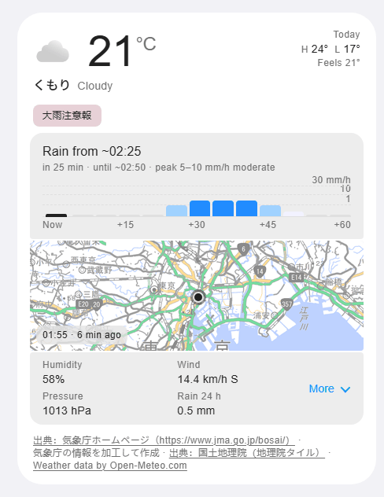
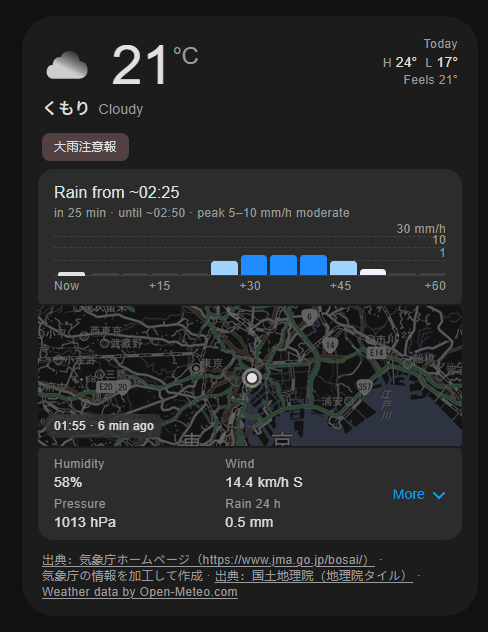
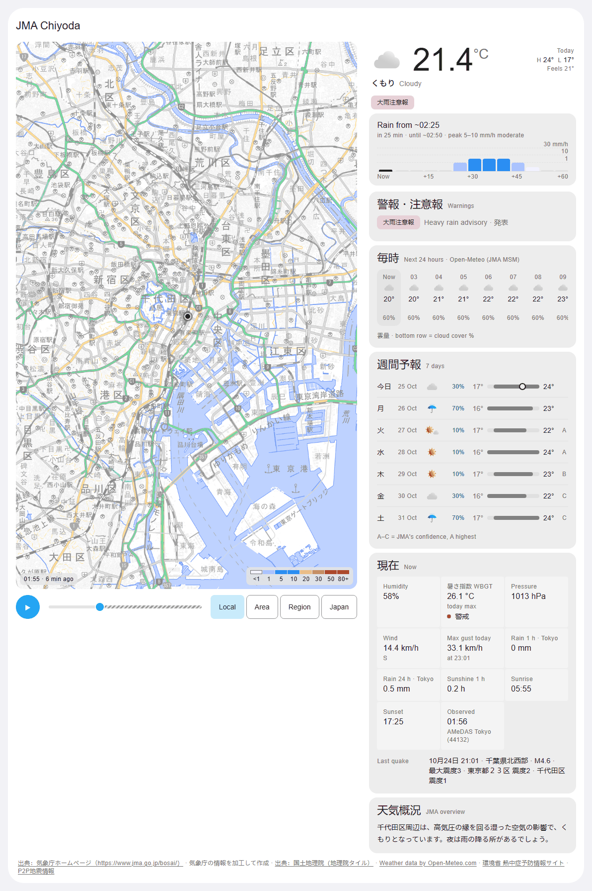
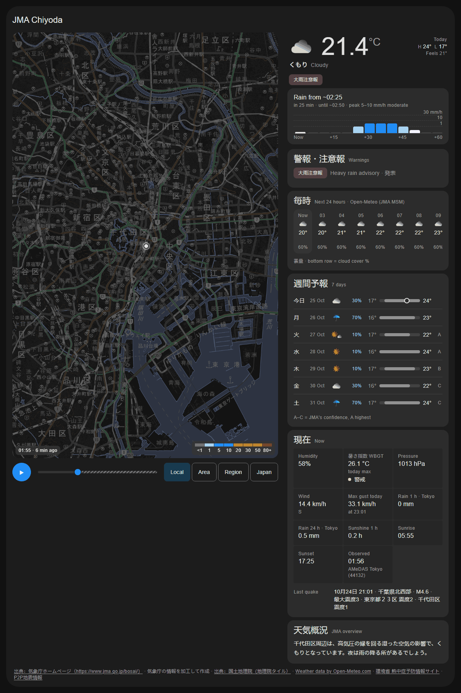

<p align="center">
  <a href="https://github.com/glockpete/ha-jma-card/actions/workflows/validate.yml"></a>
  <a href="https://github.com/glockpete/ha-jma-card/actions/workflows/tests.yml"></a>
  <a href="https://github.com/hacs/integration"></a>
  <a href="LICENSE"></a>
</p>

# JMA Weather Card (Unofficial)

A Home Assistant dashboard card for the [ha-jma](https://github.com/glockpete/ha-jma) integration: the forecast, JMA
warnings, next-hour rain and a rain radar for a place in Japan, in one card.

The card shows what the integration collected from the public files of
[気象庁 (the Japan Meteorological Agency, JMA)](https://www.jma.go.jp/). It needs the integration; it does not fetch
weather data by itself. The services that stand behind it are listed in [Attribution and licences](#attribution-and-licences).

> **Important.** This is a community project. JMA did not make it, does not endorse it and does not support it.
> **Do not use it for evacuation or safety decisions, and do not rely on it as your only way to learn of a
> danger.** It is a convenience for a dashboard, not a warning system.

<p align="center">
  <a href="https://my.home-assistant.io/redirect/hacs_repository/?owner=glockpete&repository=ha-jma-card&category=plugin"></a>
</p>

日本語 / Japanese: [README.ja.md](README.ja.md)

## Contents

- [Screenshots](#screenshots)
- [Features](#features)
- [Requirements](#requirements)
- [Install](#install)
- [Configuration](#configuration)
  - [Base map](#base-map)
  - [Entities the card finds for you](#entities-the-card-finds-for-you)
  - [Lightning](#lightning)
  - [The alert entity](#the-alert-entity)
- [Examples](#examples)
- [Languages](#languages)
- [Theming](#theming)
- [Privacy](#privacy)
- [Troubleshooting](#troubleshooting)
- [Attribution and licences](#attribution-and-licences)
- [Contributing](#contributing)
- [Licence](#licence)

## Screenshots

<table>
  <tr>
    <td width="50%"></td>
    <td width="50%"></td>
  </tr>
  <tr>
    <td align="center"><sub>Compact, light theme</sub></td>
    <td align="center"><sub>Compact, dark theme</sub></td>
  </tr>
  <tr>
    <td width="50%"></td>
    <td width="50%"></td>
  </tr>
  <tr>
    <td align="center"><sub>Full, light theme</sub></td>
    <td align="center"><sub>Full, dark theme</sub></td>
  </tr>
</table>

The screenshots show example data for Chiyoda, Tokyo.

## Features

- **Now.** Temperature, JMA's condition name in Japanese with an English gloss, the day's high and low, the
  feels-like temperature and JMA's weather icon.
- **Warnings.** Chips in JMA's warning colours, highest level first, and the キキクル risk level. A feed that cannot be
  reached never reads as "nothing in force".
- **Notice lines**, only when there is something to say: tsunami, heat-stroke alert, feed problem, earthquake feed
  reconnecting, and advice from an optional alert entity. In compact mode also a typhoon within 500 km and a
  lightning strike within 50 km.
- **Next-hour rain chart** from the 5-minute nowcast, and the rain outlook for the hours after.
- **Radar.** A thumbnail in compact mode. In full mode a loop (play, scrub, zoom presets) with map layers: rain
  radar, 1-hour rain for the next 15 hours, thunder and tornado nowcast with lightning strikes, キキクル, the
  flood-hazard map and the Himawari infrared image.
- **Hourly forecast, 7-day list and details** (humidity, pressure, wind, the day's maximum gust, rain, sunshine,
  sunrise and sunset, the heat index WBGT, the last earthquake). In compact mode they sit in a drop-down under the
  radar.
- **Full mode only:** a typhoon section with the track on the map, and a nationwide forecast table (全国).
- **Entities found for you.** Give the card one weather entity; it finds the rest on the same device.
- **A visual editor**, light and dark themes that follow Home Assistant, and card-mod friendly colour variables.

## Requirements

- The [ha-jma](https://github.com/glockpete/ha-jma) integration, version 0.7.0 or newer, set up for at least one
  place. The card reads the integration's entities: a weather entity (for example `weather.jma_chiyoda`) and its
  sensors.
- Home Assistant 2026.9 or newer. This is the minimum declared in `hacs.json`.
- For the radar, enable the integration's `radar_frames` sensor, and for the nationwide table the `japan` sensor.
  The integration creates both disabled; see [Entities the card finds for you](#entities-the-card-finds-for-you).
- A browser that can reach JMA and the Geospatial Information Authority of Japan (GSI) for the map, or the server
  of the [base map](#base-map) you choose instead. See [Privacy](#privacy).

## Install

### With HACS

1. Select the **Open in HACS** button above. Or, in HACS, open the three-dot menu, select **Custom repositories**,
   enter `https://github.com/glockpete/ha-jma-card` and select the type **Dashboard**.
2. Download **JMA Weather Card (Unofficial)**.
3. Reload the browser page. HACS adds the dashboard resource for you when your dashboards are in the default
   (storage) mode. If the card is not found, add the resource by hand as in step 2 under "By hand", with the URL
   that HACS shows for the card.
4. Add the card to a dashboard (see [Examples](#examples)).

### By hand

1. Download `ha-jma-card.js` from the source of the [latest release](https://github.com/glockpete/ha-jma-card/releases/latest)
   (the file at the root of the tag, or inside the source-code zip) and copy it to the `www` folder of your Home Assistant configuration (`/config/www/`).
2. Add a dashboard resource with the URL `/local/ha-jma-card.js` and the type **JavaScript module**. In a
   YAML-mode setup that is:

   ```yaml
   lovelace:
     resources:
       - url: /local/ha-jma-card.js
         type: module
   ```

3. Reload the browser page.

## Configuration

Only `entity` is required. Everything else has a default. Unknown top-level keys such as `grid_options` or
`visibility` are Home Assistant's own and are left alone. A wrong value shows an error in the card's place, starting
with `ha-jma-card:`.

| Key | Type | Default | What it does |
|---|---|---|---|
| `type` | text | | Always `custom:ha-jma-card`. |
| `entity` | entity id | | **Required.** A `weather.` entity of the ha-jma integration, for example `weather.jma_chiyoda`. |
| `mode` | `compact` or `full` | `compact` | `compact` is a card for a normal column. `full` shows every section open with a radar loop and is made for a panel view. |
| `title` | text | empty | A header inside the card. No header when empty. |
| `icon` | icon | empty | An icon beside the title, for example `mdi:weather-partly-cloudy`. Full mode only, and only with a `title`. |
| `square` | `true` or `false` | `false` | Compact only. Keeps the closed card 1:1; opening the drop-down lets it grow downward. |
| `show_radar` | `true` or `false` | `true` | Compact only. `false` hides the radar thumbnail. |
| `base_map` | `gsi`, `osm`, `esri`, or a mapping | `gsi` | The map under the radar. `gsi` is the pale map of the Geospatial Information Authority of Japan. A mapping `{url, attribution, max_zoom}` uses your own https tile server (YAML only). See [Base map](#base-map). |
| `navigate` | text | empty | Compact only. A dashboard path, for example `/lovelace/weather`, that opens when you tap the radar or the next-hour chart. Empty: they are not links. |
| `zoom` | number, 3 to 16 | `10` | Compact only. The map zoom of the radar thumbnail. |
| `home` | `[latitude, longitude]` | empty | Where the radar is centred. Empty: the `radar_frames` sensor's home, then Home Assistant's own location. `{latitude: …, longitude: …}` is accepted too. |
| `spans` | list of numbers (km) | `[15, 60, 250, 3000]` | Full mode. The zoom presets: how many kilometres the radar is wide at each. |
| `zoom_labels` | list of text | `[Local, Area, Region, Japan]` | Full mode. The label of each preset button. A preset without a label shows `<km> km`. |
| `hours` | whole number, 1 to 72 | `24` | How many hours of the hourly forecast are listed. |
| `entities` | mapping | empty | Names ha-jma entities by hand. Only needed to replace one the card finds. See [Entities the card finds for you](#entities-the-card-finds-for-you). |
| `lightning` | mapping | empty | Optional Blitzortung lightning. See [Lightning](#lightning). |
| `alert_entity` | entity id | empty | Optional entity whose advice the card shows. See [The alert entity](#the-alert-entity). |

The visual editor (Edit, then the card) shows `entity`, `title`, `icon`, `mode`, `square`, `show_radar`, `base_map`
(a choice of `gsi`, `osm` and `esri`), `navigate`, `alert_entity`, `entities` and `lightning`. The other keys are set
in YAML, and so is a custom `base_map`; the editor leaves them as they are.

### Base map

`base_map` picks the pictures under the radar. The default is `gsi`: the pale map (淡色地図) of the Geospatial
Information Authority of Japan (国土地理院, GSI), which needs no key. The credit line on the card always names the base
map in use, and only that one.

| `base_map` | Tiles | Highest zoom asked for | Labels | Credit on the card | Terms |
|---|---|---|---|---|---|
| `gsi` (default) | GSI pale map, `https://cyberjapandata.gsi.go.jp/xyz/pale/{z}/{x}/{y}.png` | 18 | in the picture | 出典：国土地理院（地理院タイル）, linked to the tile list | <https://maps.gsi.go.jp/development/ichiran.html>: tiles loaded live in an app need no application, only the source and a link to that page. Content terms: <https://www.gsi.go.jp/kikakuchousei/kikakuchousei40182.html> |
| `osm` | OpenStreetMap standard tiles, `https://tile.openstreetmap.org/{z}/{x}/{y}.png` | 19 | in the picture | © OpenStreetMap contributors, linked to <https://www.openstreetmap.org/copyright> | Tile usage policy, <https://operations.osmfoundation.org/policies/tiles/>: availability is best effort with no guarantee, and heavy use is not allowed. |
| `esri` | Esri World Light Gray, Base and Reference (legacy) | 16 | a separate layer above the radar | Esri, HERE, Garmin, © OpenStreetMap contributors | Summary, <https://goto.arcgis.com/termsofuse/viewsummary>: "Use with Esri software and comply with its terms of use. If you do not have Esri software, you must purchase an ArcGIS Online subscription." The item is in mature support and tagged for retirement in December 2029. |
| a mapping | your own tile server | `max_zoom` (default 18) | in the picture | your `attribution`, else `Map tiles: <host>` | yours |

- **GSI.** The tiles run from zoom 2 to 18. Zoom 2 to 8 covers the world; zoom 5 to 18 covers Japan and its
  surroundings, so a map centred outside Japan is blank above zoom 8. The tile list asks for the source "国土地理院" or
  "地理院タイル" with a link to <https://maps.gsi.go.jp/development/ichiran.html>, which is the credit line. For zoom 8
  and lower the list also asks for the shoreline notice (Vector Map Level 0, NIMA and USGS); it is in the credit line's
  tooltip.
- **OpenStreetMap.** `tile.openstreetmap.org` is run by volunteers. Use it for a light dashboard, or point a custom
  `base_map` at your own tile server.
- **Esri** stays as a choice for those who hold the licence it asks for. It is not the default because its terms
  want Esri software or an ArcGIS Online subscription, and the legacy item is retiring.
- **Labels.** `gsi`, `osm` and a custom map carry their labels in the picture, so the radar is drawn over them. `esri`
  draws its labels above the radar.
- **Dark themes.** The map is darkened with a filter for every base map.

A custom base map is set in YAML (the editor leaves it alone):

```yaml
type: custom:ha-jma-card
entity: weather.jma_chiyoda
base_map:
  url: https://tiles.example.org/{z}/{x}/{y}.png
  attribution: "© Example Tiles"
  max_zoom: 18
```

`url` must start with `https://` and contain `{z}`, `{x}` and `{y}`; any other `{…}` is an error. A key for the server
can go in the query (`?key=…`), but not as `user:password@`. `attribution` is plain text; left out, the card shows
`Map tiles: <host>`. `max_zoom` is a whole number from 2 to 22: above it the card stretches the tiles of that zoom. Give
the credit your tile provider asks for.

### Entities the card finds for you

The card finds the ha-jma entities that belong to the same device as your weather entity, so one line is enough.
`entities:` names one by hand and wins. A role with no entity hides only its own part of the card.

| Role (`entities.<role>`) | Found as (the integration's entity) | Used for |
|---|---|---|
| `warnings` | `sensor.jma_<place>_warning_level` | warning chips and the warnings tab |
| `rain` | `sensor.jma_<place>_rain_next_hour` | the next-hour rain chart |
| `frames` | `sensor.jma_<place>_radar_frames` | radar frames and map layers. Disabled by default in ha-jma: enable it for the radar |
| `overview` | `sensor.jma_<place>_overview` | JMA's text overview |
| `feed` | `binary_sensor.jma_<place>_feed_problem` | the feed-problem notice |
| `quake` | `sensor.jma_<place>_last_earthquake` | the last-earthquake line and the quake-feed notice |
| `outlook` | `sensor.jma_<place>_warning_outlook` | JMA's 3-hourly warning outlook |
| `typhoon` | `sensor.jma_<place>_typhoon` | typhoon lines and the track |
| `wbgt` | `sensor.jma_<place>_wbgt` | the heat-index tile. The integration creates it for the Tokyo office only |
| `kikikuru` | `sensor.jma_<place>_kikikuru` | the キキクル chip |
| `rain_outlook` | `sensor.jma_<place>_rain_outlook` | the rain outlook after the next hour |
| `japan` | `sensor.jma_<place>_japan` | the nationwide table. Disabled by default in ha-jma: enable it for the table |
| `tsunami` | `sensor.jma_<place>_tsunami` | the tsunami notice |
| `heat_alert` | `sensor.jma_<place>_heat_alert` | the heat-stroke notice |
| `sun` | `sun.sun` (Home Assistant's own) | day or night for the icons, and sunrise and sunset |

`<place>` is the lower-case English name of the municipality, for example `chiyoda`. The card matches the entities by
the integration's `translation_key`, not by name, so a renamed entity is still found. A weather entity that is not in
Home Assistant's entity registry, or has no device, finds nothing: name the entities by hand then. An unknown role
under `entities:` is an error.

### Lightning

Lightning is off until you configure it. It uses the [Blitzortung](https://github.com/mrk-its/homeassistant-blitzortung)
integration for Home Assistant.

| Key (`lightning.<key>`) | Type | Default | What it does |
|---|---|---|---|
| `distance` | entity id | empty | The sensor with the distance of the latest strike. |
| `azimuth` | entity id | empty | The sensor with the direction of the latest strike. |
| `counter` | entity id | empty | The strike-counter sensor. Naming one that exists also adds the Blitzortung.org credit to the card. |
| `source` | text | `blitzortung` | The `source` attribute of the strike (`geo_location`) entities the card draws. |
| `minutes` | number above 0 | `30` | A strike older than this is not drawn. |

The entity ids depend on how your Blitzortung entry is named; look them up in **Settings > Devices & services**.
An unknown key under `lightning:` is an error.

### The alert entity

`alert_entity` is optional. It names an entity that carries advice for an alert, for example a template sensor you
build yourself. The ha-jma integration does not create one. The card reads these attributes of it:

| Attribute | Meaning |
|---|---|
| `advice` | The text of the advice. |
| `time` | When it was issued: ISO 8601 **with a zone**. A time without a zone is not trusted. |
| `test` | Must be `false`. A test alert is never shown. |
| `hazard` | `quake`, `warning`, `typhoon`, `tsunami`, `heat` or `eew`. |
| `level` | `emergency` or `urgent` marks the line in the accent colour. |
| `guidance` | `tsunami_home`, `tsunami_advisory` or `tsunami_elsewhere`: ties the advice to one tsunami line. |
| `message` | The text of an early earthquake warning (`hazard: eew`). |

The advice shows as "What to do" while it is at most 6 hours old, or for as long as its own tsunami or heat line is
on the card. An early earthquake warning with `level` `emergency` or `urgent` shows for two minutes.

## Examples

The smallest card:

```yaml
type: custom:ha-jma-card
entity: weather.jma_chiyoda
```

A compact card with a title that opens a weather view when you tap the radar:

```yaml
type: custom:ha-jma-card
entity: weather.jma_chiyoda
title: Chiyoda
square: true
navigate: /lovelace/weather
```

Full mode, in a panel view (the radar goes to the left from 880 px wide):

```yaml
views:
  - title: Weather
    type: panel
    cards:
      - type: custom:ha-jma-card
        entity: weather.jma_chiyoda
        mode: full
        title: Chiyoda
        icon: mdi:weather-partly-cloudy
        hours: 36
        spans: [15, 60, 250, 3000]
        zoom_labels: [Local, Area, Region, Japan]
```

Entities named by hand (all optional; the card finds them by itself otherwise):

```yaml
type: custom:ha-jma-card
entity: weather.jma_chiyoda
entities:
  warnings: sensor.jma_chiyoda_warning_level
  frames: sensor.jma_chiyoda_radar_frames
  sun: sun.sun
```

With lightning from Blitzortung:

```yaml
type: custom:ha-jma-card
entity: weather.jma_chiyoda
lightning:
  distance: sensor.blitzortung_lightning_distance
  azimuth: sensor.blitzortung_lightning_azimuth
  counter: sensor.blitzortung_lightning_counter
  minutes: 30
```

With a radar centred on a point of your choice (Tokyo Station, as an example):

```yaml
type: custom:ha-jma-card
entity: weather.jma_chiyoda
home: [35.6812, 139.7671]
```

With OpenStreetMap as the base map instead of GSI's:

```yaml
type: custom:ha-jma-card
entity: weather.jma_chiyoda
base_map: osm
```

## Languages

The card is bilingual by design.

- **JMA's own terms stay in Japanese**, with an English label next to them: warning names, 震度, キキクル,
  天気概況 (the text overview) and the weekday in the 7-day list.
- **Dates, times and numbers follow Home Assistant.** The language is `hass.locale.language` and the time zone is
  `hass.config.time_zone`. Times are 24-hour. The Japanese-side dates (月日, 曜日) are always Japanese, as in JMA's
  own style.
- **Temperatures follow the weather entity's `temperature_unit`** (°C, °F or K). The heat index (WBGT) is always in
  °C, as the Ministry of the Environment publishes it.
- The card's own labels are English. There is no translation file.

## Theming

The colours follow your Home Assistant theme, light or dark, and a Material 3 theme if you use one. To override one,
set a `--jma-card-<name>` variable (for example with card-mod). The names are `ink`, `muted`, `line`, `outline`,
`ground`, `primary`, `on-primary`, `secondary`, `error`, `accent` and `rain`, and the tonal layers `panel`, `well`,
`tile`, `primary-container`, `on-primary-container`, `secondary-container`, `on-secondary-container`,
`error-container`, `on-error-container`, `coral-container` and `on-coral-container`. `--jma-card-font` and
`--jma-card-radius` set the font and the corner radius. The data scales (JMA's rain bands, warning levels and map
legends) are fixed colours.

## Privacy

- The card has no server and no account. It reads entity states from Home Assistant.
- **Your browser loads map tiles and weather icons straight from the servers of JMA and GSI**, and, on the
  thunder layer in full mode, JMA's lightning files. With `base_map` set to `osm`, `esri` or a custom server, the base
  map tiles come from that server instead of GSI's. Those servers see your browser's address and the tile
  addresses, which point to the area on screen. This is how a map card works. In compact mode, `show_radar: false`
  stops the map tiles; the weather icons still come from JMA's server.
- The card remembers whether the drop-down is open, the tab, and the radar layer in your browser's local storage.
- `home` puts coordinates in your dashboard configuration. Leave it out unless the radar is centred wrongly.

## Troubleshooting

- **"Custom element doesn't exist: ha-jma-card".** The resource is not loaded. Check that the resource URL is right
  (`/local/ha-jma-card.js` for a manual install) and reload the browser page without its cache.
- **A message starting with `ha-jma-card:`.** The configuration has a wrong value; the message says which.
- **No radar frames.** The `radar_frames` sensor is disabled by default in ha-jma. Enable it in the entity's
  settings.
- **No nationwide table.** The `japan` sensor is disabled by default in ha-jma. Enable it.
- **No heat-index tile.** The integration creates the WBGT sensor for the Tokyo office only, and it is unavailable
  out of season.
- **A value looks wrong.** The values come from the integration. Check the entity first, and report a wrong or
  missing value to [ha-jma](https://github.com/glockpete/ha-jma/issues).

## Attribution and licences

**Unofficial: this card is not affiliated with or endorsed by the Japan Meteorological Agency.** The agency did not
make it. The card edits JMA's information, which is why it carries the statement 気象庁の情報を加工して作成 (made by
processing JMA's information).

Credit lines are on the card itself. The first two are there in every mode, with or without data. The others are added
while data from them is on screen.

| Credit on the card | Shown | Terms |
|---|---|---|
| 出典：気象庁ホームページ（https://www.jma.go.jp/bosai/） and 気象庁の情報を加工して作成 | always | JMA's terms, <https://www.jma.go.jp/jma/kishou/info/coment.html>: the Public Data License, 公共データ利用規約（第1.0版）, unless a page says otherwise. They ask for the source and, separately, a statement that the content was edited. |
| 出典：国土地理院（地理院タイル） | while a map is drawn and `base_map` is `gsi` (the default) | GSI's tile list and terms, <https://maps.gsi.go.jp/development/ichiran.html>. The credit links to that page. See [Base map](#base-map). |
| © OpenStreetMap contributors | while a map is drawn and `base_map` is `osm` | Tile usage policy, <https://operations.osmfoundation.org/policies/tiles/>. Copyright, <https://www.openstreetmap.org/copyright> |
| Esri, HERE, Garmin, © OpenStreetMap contributors | while a map is drawn and `base_map` is `esri` | Esri's terms summary, <https://goto.arcgis.com/termsofuse/viewsummary>. Map data © OpenStreetMap contributors, <https://www.openstreetmap.org/copyright> |
| your `attribution`, or `Map tiles: <host>` | while a map is drawn and `base_map` is a custom mapping | Your tile provider's terms. |
| Weather data by Open-Meteo.com | while the hourly strip or the feels-like figure is shown | CC BY 4.0, <https://open-meteo.com/en/licence>. The free API is for non-commercial use only. |
| 環境省 熱中症予防情報サイト | while the heat-index tile or a heat-stroke line is shown | The ministry's terms, <https://www.wbgt.env.go.jp/en/tos.php> |
| P2P地震情報 | while a last-earthquake line or a tsunami line is shown | <https://www.p2pquake.net/> |
| Blitzortung.org | when `lightning.counter` names an entity that exists | <https://www.blitzortung.org/> |

Also on screen:

- **Radar and キキクル tiles, weather icons, and the Himawari image** are JMA's.
- **The flood-hazard layer** (洪水浸水想定区域) is the Geospatial Information Authority of Japan's hazard-map data
  (<https://disaportal.gsi.go.jp/>). Its credit line is the one the integration's `radar_frames` sensor sends, and the
  card shows it under the layer's legend.

If you show the card in a public place, give the credits the services ask for. Their terms apply to you as the user.
Some content is restricted by law (気象業務法, the Meteorological Service Act).

## Contributing

Bug reports and pull requests are welcome; see [CONTRIBUTING.md](CONTRIBUTING.md). Run the tests with
`node --test "test/*.test.cjs"`. A problem with the data itself belongs to the
[integration](https://github.com/glockpete/ha-jma/issues). To report a security problem privately, see
[SECURITY.md](SECURITY.md).

## Licence

[MIT](LICENSE). The weather data and maps the card shows have their own terms, listed in
[Attribution and licences](#attribution-and-licences).
